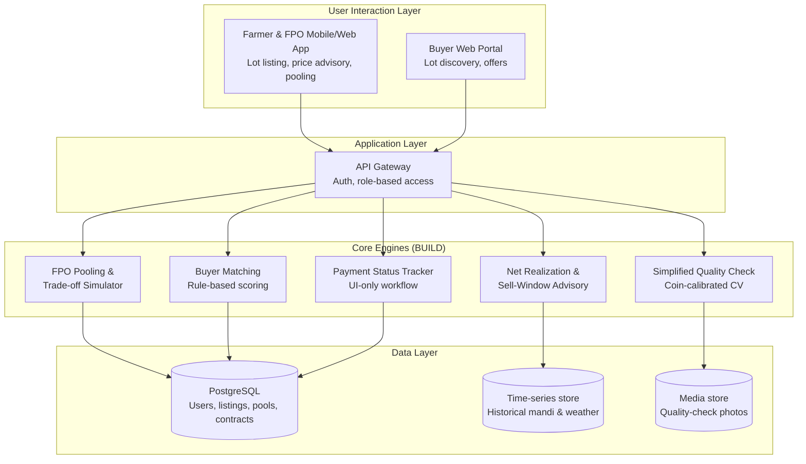
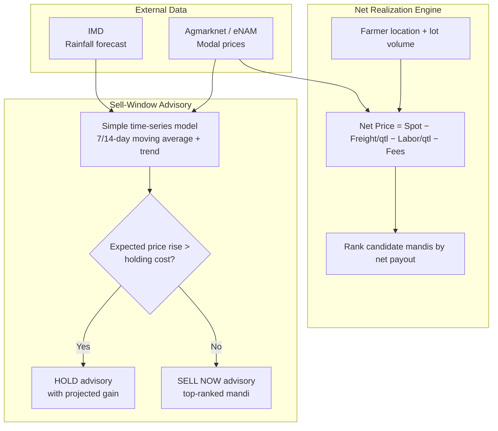
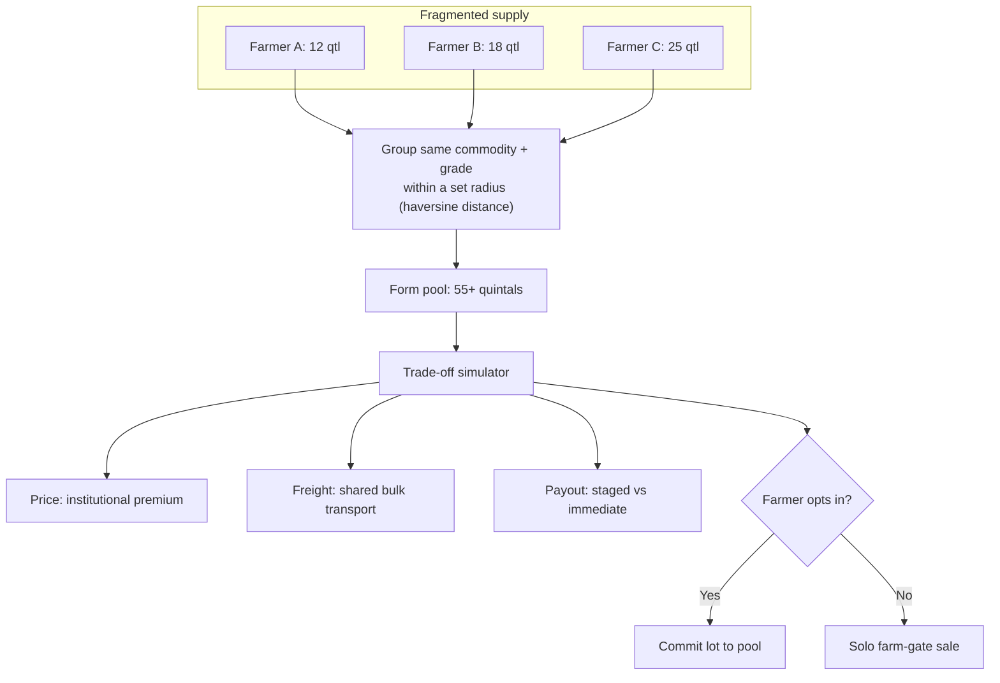
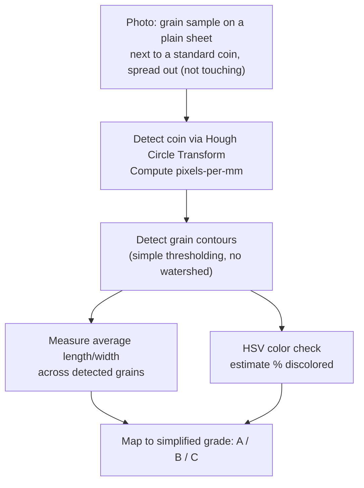
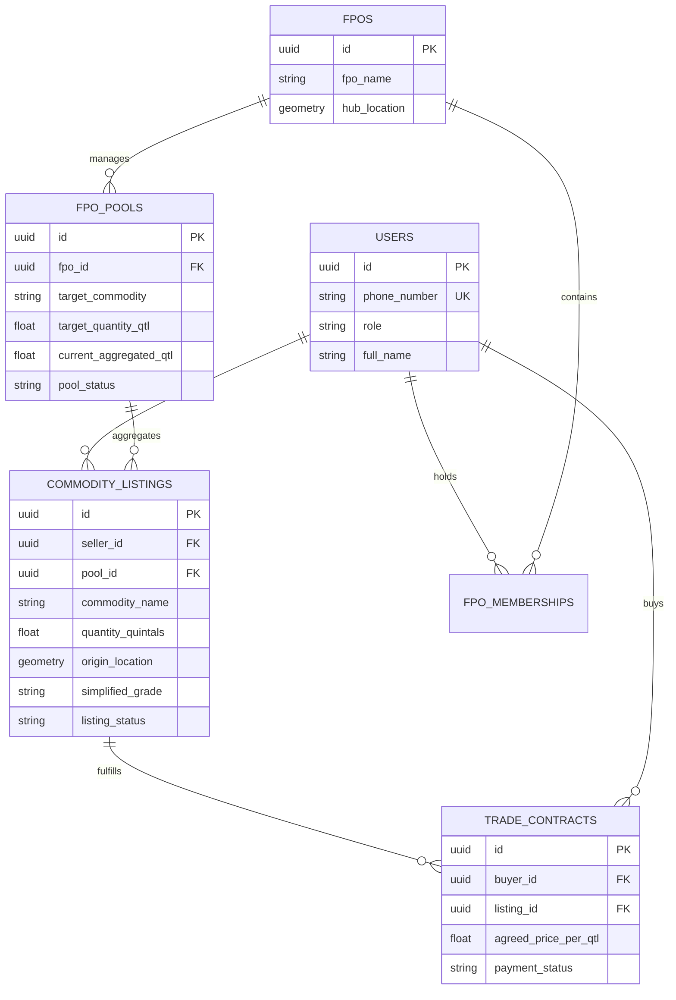
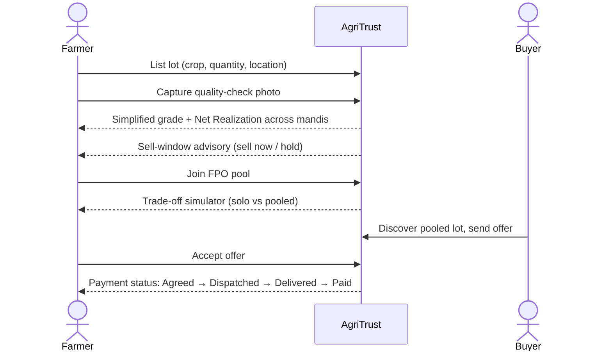

# AgriTrust: Market Intelligence & Trade-Enablement Platform for Farmers
## Feasibility-Scoped Build Specification (v2)

> This version restructures the original design around one rule: every module is labeled as either **BUILD** (will run live in the demo) or **ROADMAP** (designed and pitched, not built). Judges respect honest scoping far more than an unlabeled wall of ambitious features.

---

## 1. Executive Summary & Problem Framing

Smallholder farmers and Farmer Producer Organizations (FPOs) face systemic friction across agricultural supply chains:

- **Information asymmetry** — farmers see a raw mandi price, not what they'd actually net after freight, labor, and market fees.
- **Weak bargaining power** — fragmented 5–20 quintal lots can't attract institutional buyers who need 200–500 quintal uniform-grade lots.
- **Subjective quality discounting** — informal grading at the farm gate leaves room for arbitrary price cuts by local traders.
- **Settlement uncertainty** — payment delays and disputes with no transparent trail.

**AgriTrust** addresses the three of these that are genuinely solvable in a hackathon timeline — price transparency, aggregation leverage, and a quality-trust signal — and designs (without over-claiming to build) the trust/verification and settlement layers needed for a production version.

---

## 2. What We're Building vs. What We're Designing Toward

This table is the single most important slide in your deck. State it explicitly and early — it preempts the "is this actually working?" question before a judge asks it.

| Module | Hackathon demo | Status |
|---|---|---|
| Net Realization calculator | Real Agmarknet price data, real freight/cost formula | ✅ **BUILD** |
| Sell-now vs. hold advisory | Working forecast model, backtested against real historical prices | ✅ **BUILD** |
| FPO pooling + trade-off simulator | Working spatial grouping on real/sample farmer data, real trade-off math | ✅ **BUILD** |
| Quality check (simplified) | Coin-calibrated single-pass measurement → 3-tier grade | ✅ **BUILD**, explicitly simplified |
| Buyer matching & listings | Working match logic against a mock buyer database | ✅ **BUILD**, buyer data is simulated |
| Payment status tracker | UI shows a deal moving through stages (agreed → dispatched → delivered → paid) | ✅ **BUILD**, no real funds move |
| Identity & land verification | Phone + name only for demo login | ⚪ **ROADMAP** — full API Setu/NGDRS integration |
| Full AGMARK-grade CV assaying | — | ⚪ **ROADMAP** — watershed segmentation, multi-parameter defect analysis |
| Real escrow & automated disbursement | — | ⚪ **ROADMAP** — requires a licensed payment aggregator partnership, flagged as a real regulatory dependency, not just an engineering task |
| Dispute arbitration workflow | — | ⚪ **ROADMAP** — described in the pitch, not functional |

---

## 3. MVP System Architecture

---

## 4. MVP Module Specs

### Module 1: Net Realization & Sell-Window Advisory — ✅ BUILD

Raw mandi prices mislead farmers because they ignore freight, labor, and market fees. This module computes the price a farmer would *actually* net.

**Net Realization formula:**

$$\text{Net Realization}_m = P_m - \left( \frac{\text{Distance}_m \times C_{km} + C_{fixed}}{V} \right) - \left( P_m \times (R_{cess} + R_{comm}) \right)$$

**Sell-window model — build the simple version first:** a 7/14-day moving average and trend line, backtested against last month's real Agmarknet prices so you have an actual accuracy number to quote. Upgrade to Prophet/LightGBM only if time remains — a working simple model beats a fragile advanced one in a live demo.

---

### Module 2: FPO Pooling & Trade-off Simulator — ✅ BUILD

**Build note:** use straightforward haversine-distance grouping in application code rather than a PostGIS extension — it's just as effective for a hackathon demo and removes a setup dependency. PostGIS is a fine upgrade path for the roadmap slide.

**Keep the trade-off table from the original design** — concrete numbers (₹/quintal, % freight savings) are one of your strongest demo moments:

| Dimension | Solo sale | Pooled sale |
|---|---|---|
| Price realization | Baseline spot price | Institutional premium |
| Freight cost | Higher (small lot) | Lower (shared bulk transport) |
| Payment timing | Immediate | Staged, tied to delivery confirmation |
| Rejection risk | 100% individual | Shared across pool |

---

### Module 3: Simplified Quality Check — ✅ BUILD (deliberately scoped down)

The original watershed-segmentation, multi-parameter AGMARK pipeline is a research-level CV problem on its own — too fragile to run live and reliably in front of judges. This version keeps the clever part (coin calibration) and drops the risky part (separating touching/clustered grains).

**Be explicit about this in the pitch:** *"This is a decision-support proxy for farmers and FPOs, not a certified AGMARK lab replacement — full multi-parameter certified grading is on our roadmap."* That one sentence turns a limitation into a sign of maturity.

---

### Module 4: Buyer Matching — ✅ BUILD (mock buyer data)

Rule-based scoring against a small synthetic buyer dataset (15–20 buyers with commodity needs, location, and a reliability score). State plainly that buyer data is simulated — no public buyer-demand dataset exists, so this isn't a gap you created.

### Module 5: Payment Status Tracker — ✅ BUILD (UI only)

A visible deal-status flow — **Agreed → Dispatched → Delivered → Paid** — with no real funds moving. This demonstrates the transaction lifecycle judges want to see without the licensing complexity of an actual escrow/payment integration.

---

## 5. Roadmap Modules (pitch, don't build)

- **Multi-tier identity & land verification** — phone/PAN plus a real API Setu/NGDRS land-record integration, hardware-bound geofencing for photo capture.
- **Full escrow & automated disbursement** — requires partnering with a licensed payment aggregator; explicitly name this as a regulatory dependency in your pitch, not just an engineering one.
- **Production-grade CV grading** — watershed segmentation for touching grains, full AGMARK multi-parameter defect analysis, at scale.
- **FPO arbitration workflow** — structured dispute resolution with SLAs.

Presenting these as a clear-eyed roadmap (not vague hand-waving) is what earns you the "scalable beyond a hackathon" evaluation point without pretending they're built.

---

## 6. Build Priority

1. **Net Realization engine** — pull real Agmarknet data, implement the formula (data lead)
2. **Sell-window advisory** — simple moving-average model, backtested (ML lead)
3. **FPO pooling + trade-off simulator** — haversine grouping, trade-off math (ML/backend lead)
4. **Simplified quality check** — coin calibration + basic contour measurement (CV lead)
5. **Buyer matching + payment status UI** — wire the full demo flow together (backend + frontend)
6. **Rehearsal** — one clean end-to-end story, with the "build vs. roadmap" table ready for Q&A

---

## 7. Data Model (MVP scope only)

Note what's gone from the original: no `LAND_HOLDINGS` cadastral fields, no `ESCROW_LEDGER` banking fields — `payment_status` is a simple enum (`agreed`/`dispatched`/`delivered`/`paid`), matching what's actually built.

---

## 8. Demo Flow

