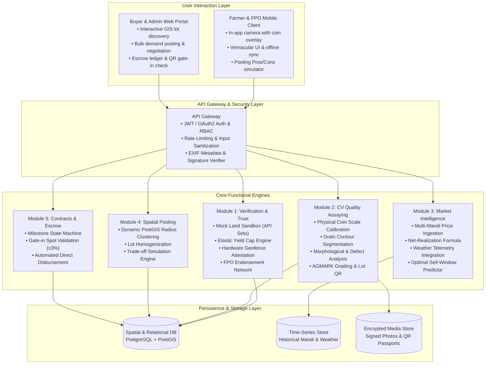

# KrishiDrishti: Farm-to-Fork Market Intelligence, Verification & Dynamic Aggregation Protocol
## Master System Specification, Functional Architecture & Deep-Dive Blueprint

---

## 1. Executive Summary & Problem Framing

Smallholder farmers and Farmer Producer Organizations (FPOs) face severe systemic friction across agricultural supply chains:
* **Information Asymmetry:** Incomplete visibility into true net market realization, freight rates, handling overheads, and future commodity price curves.
* **Opaque Quality Arbitrage:** Subjective manual grading at the farm gate leading to arbitrary price discounting by local traders.
* **Weak Bargaining Power:** Fragmented sub-scale lots (5–20 quintals) fail to attract institutional bulk buyers who require 200–500 quintal lots of uniform grade.
* **Counterparty & Settlement Risk:** Payment delays, absence of escrow protection, and speculative ghost listings by unauthorized middlemen.

**KrishiDrishti** is an end-to-end decentralized market intelligence, verification, and transaction-enablement platform engineered to resolve these bottlenecks through:
1. **Multi-Tiered Verification & Anti-Fraud Architecture:** Hardware-bound geofencing, simulated API Setu/NGDRS land record sandboxes, dynamic yield caps accounting for carryover stock/informal pooling, and FPO peer-endorsements.
2. **Deterministic Computer Vision Assaying:** Physical coin-calibrated reference scale detection for automated morphological grain analysis and AGMARK grading.
3. **Net-Realization & Predictive Sell-Window Engine:** Spatial logistics optimization, holding cost evaluation, and seasonal price forecasting.
4. **Algorithmic FPO Spatial Pooling Engine:** Dynamic radius clustering with a transparent **Pros & Cons Trade-off Simulator**.
5. **Milestone-Driven QR Escrow Protocol:** Gate-in spot validation, tolerance bands, and automated disbursement.

---

## 2. High-Level System Architecture



## 3. Detailed Modular Breakdowns

### Module 1: Multi-Tier Verification & Anti-Fraud Engine

To eliminate ghost listings and speculative arbitrage without imposing prohibitive identity hurdles on smallholders, KrishiDrishti uses a progressive verification pipeline.

Code snippet

```
flowchart TD
    Start([User Registration]) --> KYC{Identity Verification}

    KYC -->|Phone + PAN / Demo Auth| Tier3[Tier 3: Bronze Status<br/>• Basic account activated<br/>• Mandatory escrow hold on sales]

    Tier3 --> LandLookup[Land Verification Step]
    LandLookup --> SetuSandbox[Mock API Setu / NGDRS Gateway<br/>Fetch Survey No, Cultivable Area Ha]

    SetuSandbox --> YieldCalc[Calculate Elastic Yield Cap<br/>Max Qty = Area * Benchmark * 1.6 + 30 qtl]

    YieldCalc --> PhotoCapture[In-App Camera Capture<br/>Live feed only - No gallery upload]
    PhotoCapture --> HardwareCheck{Hardware & EXIF Check}

    HardwareCheck -->|Valid GPS in Ag Zone + Fresh Timestamp| Tier2[Tier 2: Silver Status<br/>• Field-verified lot<br/>• Standard trading enabled]
    HardwareCheck -->|Failed Geofence / Metadata| FlagReview[Flagged for Manual Review]

    Tier2 --> QuantityCheck{Listing Qty <= Max Cap?}
    QuantityCheck -->|Yes| PublishListing[Listing Approved & Published]
    QuantityCheck -->|No: Exceeds Cap| FPOAudit[Route to FPO Physical Audit]

    FPOAudit --> FPOEndorse{FPO Admin Sign-off?}
    FPOEndorse -->|Approved| Tier1[Tier 1: Gold Status<br/>• Certified Premium Lot<br/>• Instant institutional discovery]
    FPOEndorse -->|Rejected| RestrictQty[Quantity capped to calculated maximum]

```

#### 1.1 Mock Government Land Sandbox (API Setu / NGDRS Emulation)

- **Design Philosophy:** Avoid external runtime dependency failures during evaluation while presenting complete production schema fidelity.
- **Emulated Endpoints:** Simulates State Land Revenue Registries via a local REST service matching official MeitY API Setu JSON specifications.
- **Payload Structure:** Returns standardized parcel records including `survey_number`, `land_owner_name`, `total_area_hectares`, `cultivable_area_hectares`, `irrigation_type`, and registered `crop_sown_record`.

#### 1.2 Generous Yield Cap & Elastic Ceiling Logic

To prevent speculative traders from masquerading as smallholders while accounting for **stored carryover harvest** and **informal local aggregation**, the platform computes an elastic listing threshold:

$$\text{Max Allowed Quantity (Quintals)} = \Big( \text{Cultivable Area (Ha)} \times Y\_{\text{bench}} \times M\_{\text{carry}} \Big) + B\_{\text{pool}}$$

- **$Y\_{\text{bench}}$ (Benchmark Yield):** District-level average productivity per hectare (e.g., $250 \text{ qtl/ha}$ for Onion; $45 \text{ qtl/ha}$ for Wheat).
- **$M\_{\text{carry}}$ (Carryover Multiplier = 1.6):** Accommodates unsold produce stored on-farm from prior harvest cycles.
- **$B\_{\text{pool}}$ (Informal Pooling Buffer = +30 Quintals):** Additive buffer enabling a registered smallholder to aggregate grain from immediate family members or adjacent un-registered plots.
- **Policy Enforcement:** Listings exceeding the calculated ceiling are flagged as `requires_fpo_endorsement` and routed to the local FPO Admin portal for physical sign-off before entering public search indices.

#### 1.3 Hardware-Bound Geofencing & Proof of Presence

- **Native Camera Constraint:** Disables OS gallery selection; forces live capture inside the mobile client.
- **Hardware Attestation:** Binds GPS coordinates (Latitude, Longitude, Altitude, Accuracy Radius) with device sensor metadata (EXIF headers, orientation angles, hardware UUID, and UTC network timestamp).
- **Spatial Validation:** Spatial queries verify that the capture point intersects designated rural/agricultural cadastral zones rather than commercial freight yards or urban centers.

#### 1.4 FPO Web of Trust (Peer Endorsement)

- Registered FPOs (holding validated corporate credentials) act as local notarization nodes.
- FPO Admins can review flagged/oversized listings from their registered member network, execute physical inspections, and issue digital endorsements that upgrade listings to **Tier 1 (Gold)**.

### Module 2: Deterministic Computer Vision (CV) Quality Assaying

Rather than relying on opaque deepfake/AI image classifiers that fail under variable rural lighting, KrishiDrishti utilizes a **deterministic physical calibration and contour analysis pipeline**.

Code snippet

```
flowchart TD
    A[In-App Camera Capture<br/>Grain sample on white sheet + standard coin] --> B[Image Pre-Processing<br/>• Verify EXIF integrity<br/>• Laplacian variance blur check]

    B --> C[Circular Hough Transform<br/>Detect coin contour & radius]
    C --> D[Compute Calibration Metric<br/>Pixels-per-mm = Detected Diameter / 25.0 mm]

    D --> E[Mask Reference Coin Region]
    E --> F[Adaptive Gaussian Thresholding<br/>Isolate grain kernels from background]

    F --> G[Distance Transform + Watershed<br/>Separate touching / clustered kernels]
    G --> H[Extract Individual Grain Contours]

    H --> I[Morphological Measurements<br/>• Major Axis Length mm<br/>• Minor Axis Width mm<br/>• Length/Width Ratio]
    H --> J[Color Space Analysis HSV/LAB<br/>• Discoloration & fungal damage<br/>• Foreign chaff matter detection]

    I --> K[Aggregate Defect Calculations<br/>• Broken Ratio: Length < 75% mean<br/>• Impurity & defect percentage]
    J --> K

    K --> L[Map to AGMARK Schedule<br/>Grade A / Grade B / Grade C / Reject]
    L --> M[Generate Lot QR Passport<br/>Cryptographically signed quality hash]

```

#### 2.1 AGMARK Quality Threshold Matrix (Example: Wheat)

| **Parameter**              | **Grade A (Premium)** | **Grade B (Standard)** | **Grade C (Fair Average)** | **Rejection Threshold** |
| -------------------------- | --------------------- | ---------------------- | -------------------------- | ----------------------- |
| **Average Length ($L$)**   | $\ge 6.8 \text{ mm}$  | $6.0 - 6.7 \text{ mm}$ | $5.5 - 5.9 \text{ mm}$     | $< 5.5 \text{ mm}$      |
| **Length/Width Ratio**     | $\ge 3.0$             | $2.5 - 2.9$            | $2.0 - 2.4$                | $< 2.0$                 |
| **Broken Kernels (%)**     | $\le 2.0\\%$          | $\le 5.0\\%$           | $\le 8.0\\%$               | $> 8.0\\%$              |
| **Discolored / Damaged**   | $\le 1.0\\%$          | $\le 3.0\\%$           | $\le 6.0\\%$               | $> 6.0\\%$              |
| **Foreign Matter / Chaff** | $\le 0.5\\%$          | $\le 1.5\\%$           | $\le 3.0\\%$               | $> 3.0\\%$              |

### Module 3: Market Intelligence & Net-Realization Optimization

Raw mandi prices displayed on traditional portals mislead farmers because they ignore transportation friction, labor, market taxes, and warehouse holding costs. KrishiDrishti computes true **Net Realization**.

Code snippet

```
flowchart TD
    subgraph Feeds["External Data Ingestion"]
        P_Feed[Agmarknet / e-NAM<br/>Spot & modal prices]
        W_Feed[Open-Meteo / IMD<br/>7-day rainfall forecasts]
        S_Feed[WDRA Repositories<br/>Warehouse capacity & rates]
    end

    subgraph NetRealization["Net Realization Calculation Engine"]
        Inputs[Farmer Location + Lot Volume]
        P_Feed --> Calc
        Inputs --> Calc[Calculate for all destination Mandis:<br/>Net Price = Spot - Freight/qtl - Labor/qtl - Taxes]
        Calc --> MandiRank[Rank Candidate Mandis by Net Payout]
    end

    subgraph Predictor["Predictive Sell-Window Engine"]
        W_Feed --> ML_Model[LightGBM / Time-Series Forecaster<br/>Predict Price Curve at t+7, t+14, t+30 days]
        P_Feed --> ML_Model
        S_Feed --> CostEval[Holding Cost Calculation<br/>Storage rate + Capital cost + Loss]

        ML_Model --> Comparison{Expected Price Rise > Holding Cost?}
        CostEval --> Comparison

        Comparison -->|Yes| RecHold[Generate 'HOLD' Advisory<br/>• Show projected gain per quintal<br/>• Direct to nearest WDRA warehouse]
        Comparison -->|No| RecSell[Generate 'SELL NOW' Advisory<br/>• Recommend top-ranked net-payout mandi]
    end

```

#### 3.1 Mathematical Formulation of Net Realization

For a farmer with commodity volume $V$ (quintals) evaluating a destination market or buyer node $m$:

$$\text{Net Realization}\_m = P\_m - \left( \frac{\text{Distance}\_m \times C\_{\text{km}} + C\_{\text{fixed}}}{V} \right) - \left( P\_m \times (R\_{\text{cess}} + R\_{\text{comm}}) \right)$$

- $P\_m$: Quoted modal/bid price at destination $m$ ($₹/\text{qtl}$).
- $\text{Distance}\_m$: Road network / Haversine distance between farm origin and destination $m$ ($\text{km}$).
- $C\_{\text{km}}$: Freight rate per kilometer for the vehicle class required by volume $V$ ($₹/\text{km}$).
- $C\_{\text{fixed}}$: Fixed loading, unloading, and weighing labor costs ($₹$).
- $R\_{\text{cess}}, R\_{\text{comm}}$: Statutory market cess and commission percentages.

#### 3.2 Predictive "Optimal Sell-Window" Algorithm

- **Time-Series Core:** LightGBM / SARIMAX trained on historical district-level modal price and arrival volume data.
- **Exogenous Variables:** 7-day rainfall forecasts, seasonal harvest progress indices, and festival consumption peaks.
- **Economic Evaluation:**

  $$\Delta P\_{\text{expected}} = \hat{P}\_{t+k} - P\_t$$

  $$\text{Holding Cost}\_k = (k \times \text{Storage Cost/Day}) + \left( P\_t \times \frac{r\_{\text{capital}}}{365} \times k \right) + (P\_t \times \text{Depreciation Loss}\_k)$$
  - If $\Delta P\_{\text{expected}} > \text{Holding Cost}\_k$: System generates **"HOLD Recommendation"** specifying optimal sale date $t+k$ and directing the farmer to the nearest certified warehouse.
  - If $\Delta P\_{\text{expected}} \le \text{Holding Cost}\_k$: System generates **"SELL NOW Recommendation"** ranking nearby mandis by immediate Net Realization.

### Module 4: Algorithmic FPO Pooling & Trade-off Simulator

Institutional buyers need scale; smallholders need leverage. The pooling engine aggregates dispersed smallholder lots while providing transparent decision metrics.

Code snippet

```
flowchart TD
    subgraph Listings["Fragmented Farm-Gate Supply"]
        L1[Farmer A: 12 qtl - Grade A]
        L2[Farmer B: 18 qtl - Grade A]
        L3[Farmer C: 25 qtl - Grade A]
        L4[Farmer D: 10 qtl - Grade A]
    end

    subgraph SpatialClustering["Spatial Clustering Engine"]
        L1 & L2 & L3 & L4 --> GeoQuery[PostGIS ST_DWithin Query<br/>Group matching commodity & grade within 15 km]
        GeoQuery --> PoolState[Form Aggregation Pool<br/>Total: 250+ quintals at central FPO hub]
    end

    subgraph DecisionSimulator["Transparent Pros & Cons Simulator"]
        PoolState --> SimUI[Present Side-by-Side Trade-offs to Farmers]
        SimUI --> Metric1[Price: +14% Institutional Bulk Premium]
        SimUI --> Metric2[Freight: -65% Shared Multi-Axle Logistics]
        SimUI --> Metric3[Payout: Staged via Escrow vs Immediate Cash]
        SimUI --> Metric4[Rejection: Shared pool buffer vs 100% individual]
    end

    SimUI --> Choice{Farmer Opts In?}
    Choice -->|Yes| LockInPool[Commit Lot to FPO Pool]
    Choice -->|No| IndividualSale[Proceed with Solo Farm-Gate Sale]

```

#### 4.1 Spatial Clustering Protocol

1. **Spatial Indexing:** System executes `ST_DWithin` queries to identify unallocated listings of identical commodity, variety, and AGMARK grade within a default $15 \text{ km}$ radius of an FPO Aggregation Hub.
2. **Pool Formation:** When aggregated quantity reaches institutional buyer demand thresholds ($\ge 200 \text{ quintals}$), the pool status transitions to `ready_for_tender`.

#### 4.2 Transparent Pros & Cons Trade-off Simulator

When a farmer considers joining a pool versus selling individually at the farm gate, the client interface presents a side-by-side trade-off analysis:

| **Decision Dimension**       | **Solo Farm-Gate Sale**                          | **Aggregated FPO Pool Sale**                                   |
| ---------------------------- | ------------------------------------------------ | -------------------------------------------------------------- |
| **Gross Price Realization**  | Baseline local spot price ($₹2,100/\text{qtl}$). | **$+14\\%$ Institutional Premium ($₹2,394/\text{qtl}$)**.      |
| **Freight Overhead**         | $₹120/\text{qtl}$ (Small individual tractor).    | **$₹42/\text{qtl}$ (Shared multi-axle bulk freight)**.         |
| **Net Payout (15 Quintals)** | $₹29,700$ total net payout.                      | **$₹35,280$ total net payout ($+₹5,580$ gain)**.               |
| **Payment Timeline**         | Immediate cash at gate.                          | **Staged payout (Escrow release upon delivery verification)**. |
| **Lot Rejection Risk**       | Borne 100% by the individual.                    | **Distributed risk across standardized FPO buffer pool**.      |
| **Contract Binding**         | Flexible, non-binding verbal agreement.          | **Digital smart contract lock with escrow security**.          |

### Module 5: Smart Digital Contracts & Milestone QR Escrow

To prevent payment default and delivery disputes, transactions execute via a finite-state-machine escrow lifecycle.

Code snippet

```
stateDiagram-v2
    [*] --> AwaitingDeposit: Buyer accepts listing/pool offer
    AwaitingDeposit --> FundsLocked: Buyer deposits 100% invoice in Escrow

    FundsLocked --> InTransit: Consignment dispatched with Digital Transit Pass
    InTransit --> ArrivedAtGate: Truck reaches buyer warehouse

    ArrivedAtGate --> QualityInspection: Buyer scans Lot QR Passport & runs 60s CV spot check

    QualityInspection --> InspectionPassed: Quality matches within ±3% tolerance
    QualityInspection --> DisputeState: Quality deviation > 3%

    InspectionPassed --> Disbursed: Escrow triggers automated release to farmers

    DisputeState --> PenaltyResolution: Apply pre-agreed discount tier
    DisputeState --> Arbitration: Route to FPO Arbitrator

    PenaltyResolution --> Disbursed: Adjusted payout released
    Arbitration --> Refunded: Consignment rejected & returned

    Disbursed --> [*]
    Refunded --> [*]

```

#### 5.1 Escrow State Machine & Tolerance Bands

1. **Contract Formalization:** Buyer accepts pool/listing terms and deposits $100\\%$ invoice value into the Escrow Vault.
2. **Transit Pass Generation:** System issues a cryptographically signed Digital Consignment Pass with pickup GPS, driver details, and lot hashes.
3. **Gate-In Inspection (Tolerance Check):** Upon arrival at the buyer facility, the receiving manager scans the Lot QR Passport and takes a 3-point confirmation photo processed by the CV engine:
   - **Within Tolerance ($\le 3.0\\%$ variation in broken/discolored ratio):** Escrow automatically settles and triggers instant disbursement to participating farmer bank accounts via integrated payment rails.
   - **Out of Tolerance ($> 3.0\\%$ variation):** The system locks the dispute state, activates the pre-agreed contractual penalty/re-grading tier (e.g., Grade A downgraded to Grade B with a standardized $5\\%$ discount), or routes to an independent FPO arbitrator.

## 4. End-to-End User Flow & Persona Journey

Code snippet

```
sequenceDiagram
    autonumber
    actor Farmer as Farmer (Mobile App)
    actor FPO as FPO Admin
    participant App as KrishiDrishti System
    actor Buyer as Institutional Buyer (Web)

    Note over Farmer,App: Stage 1: Registration & Listing
    Farmer->>App: Input Survey Number & Phone
    App->>App: Verify Land in Mock Setu Sandbox
    App->>App: Evaluate Elastic Yield Cap
    Farmer->>App: Capture photo with coin reference
    App->>App: Run CV pipeline -> Assign AGMARK Grade A
    App-->>Farmer: Issue Cryptographic Lot QR Passport

    Note over Farmer,App: Stage 2: Intelligence & Decision
    App-->>Farmer: Display Net Realization: Solo (₹2,120) vs FPO Pool (₹2,390)
    Farmer->>App: Select 'Join Aggregation Pool'
    App->>FPO: Group 10 farmers -> Form 250 qtl bulk lot

    Note over Buyer,App: Stage 3: Contracting & Escrow
    Buyer->>App: Discover 250 qtl Grade A lot on GIS map
    Buyer->>App: Accept terms & deposit 100% funds in Escrow
    App-->>Farmer: Notify contract locked & dispatch scheduled

    Note over Farmer,Buyer: Stage 4: Delivery & Settlement
    Farmer->>Buyer: Dispatch consolidated consignment
    Buyer->>App: Scan Lot QR at gate & run 60s CV spot check
    App->>App: Verify quality within ±3% tolerance
    App->>Farmer: Automated direct disbursement to bank accounts

```

## 5. Persistence Data Model (Entity Relationship Diagram)

Code snippet

```
erDiagram
    USERS ||--o{ LAND_HOLDINGS : owns
    USERS ||--o{ FPO_MEMBERSHIPS : holds
    FPOS ||--o{ FPO_MEMBERSHIPS : contains
    USERS ||--o{ COMMODITY_LISTINGS : creates
    LAND_HOLDINGS ||--o{ COMMODITY_LISTINGS : bounds
    FPOS ||--o{ FPO_POOLS : manages
    FPO_POOLS ||--o{ COMMODITY_LISTINGS : aggregates
    FPO_POOLS ||--o{ TRADE_CONTRACTS : fulfills
    COMMODITY_LISTINGS ||--o{ TRADE_CONTRACTS : fulfills
    USERS ||--o{ TRADE_CONTRACTS : buys
    TRADE_CONTRACTS ||--|| ESCROW_LEDGER : secures

    USERS {
        uuid id PK
        string phone_number UK
        string role
        string full_name
        string pan_number
        string agristack_id
        string trust_tier
        boolean is_phone_verified
    }

    LAND_HOLDINGS {
        uuid id PK
        uuid farmer_id FK
        string state
        string district
        string survey_number
        float cultivable_area_ha
        geometry farm_location
        boolean is_mock_verified
    }

    FPOS {
        uuid id PK
        string fpo_name
        string mca_cin_number UK
        geometry hub_location
        float operational_radius_km
    }

    FPO_POOLS {
        uuid id PK
        uuid fpo_id FK
        string pool_code UK
        string target_commodity
        string target_grade
        float target_quantity_qtl
        float current_aggregated_qtl
        geometry hub_pickup_location
        string pool_status
    }

    COMMODITY_LISTINGS {
        uuid id PK
        uuid seller_id FK
        uuid land_holding_id FK
        uuid pool_id FK
        string commodity_name
        float quantity_quintals
        float asking_price_per_qtl
        geometry origin_location
        float cv_mean_length_mm
        float cv_broken_ratio_pct
        string assigned_grade
        string qr_passport_hash UK
        string listing_status
    }

    TRADE_CONTRACTS {
        uuid id PK
        string contract_number UK
        uuid buyer_id FK
        uuid pool_id FK
        uuid solo_listing_id FK
        float agreed_price_per_qtl
        float total_quantity_qtl
        float total_contract_value
        float allowed_tolerance_pct
        string contract_status
    }

    ESCROW_LEDGER {
        uuid id PK
        uuid contract_id FK
        uuid buyer_id FK
        float total_escrow_amount
        float platform_fee
        float net_seller_disbursement
        string escrow_status
        timestamp funded_at
        timestamp released_at
    }
```
